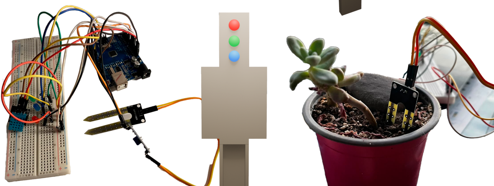

## Hipótesis a prueba

### Cadena de sensado

**Sequedad ambiental** → **Humedad y temperatura** → **Sensor** → **% / °C** → **Nivel de sequedad** → **Alerta**

Para nuestro primer diseño, decidimos que fuera una estaca que se pusiera en el suelo y te entregara información vía las luces, por lo que nuestra tarea ahora es comprobar si los sensores permiten identificar cambios de temperatura y humedad de forma clara, y si estos datos pueden traducirse en una alerta comprensible para el usuario.

  
  

