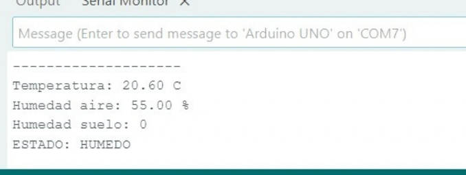
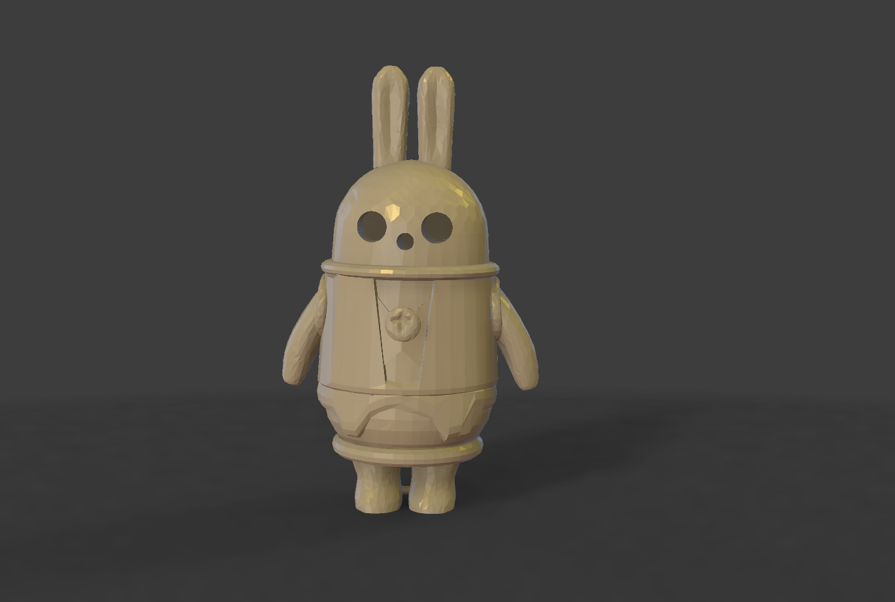

## Hipótesis a prueba

### Cadena de sensado

**Sequedad ambiental** → **Humedad y temperatura** → **Sensor** → **% / °C** → **Nivel de sequedad** → **Alerta**

Para nuestro primer diseño, decidimos que fuera una estaca que se pusiera en el suelo y te entregara información vía las luces, por lo que nuestra tarea ahora es comprobar si los sensores permiten identificar cambios de temperatura y humedad de forma clara, y si estos datos pueden traducirse en una alerta comprensible para el usuario.

  
  

## Propuesta final

Luego de definir el problema y plantear una posible solución, surgió una nueva interrogante: ¿a qué tipo de usuario debería estar dirigida nuestra propuesta?

Decidimos enfocarnos en los más jóvenes, especialmente en aquellos que aún no tienen una idea clara de cómo funciona la propagación del fuego y cómo la sequedad del entorno puede favorecerla.

Así nace **Fire Bunny**, un dispositivo cuyo diseño se asemeja al de un juguete, buscando generar interés y curiosidad a través de su apariencia. La propuesta está pensada para ser utilizada en instituciones educativas, principalmente por niños que cursan la enseñanza básica, con el objetivo de acercarlos a la prevención de incendios de una manera didáctica, interactiva y llamativa.

  

